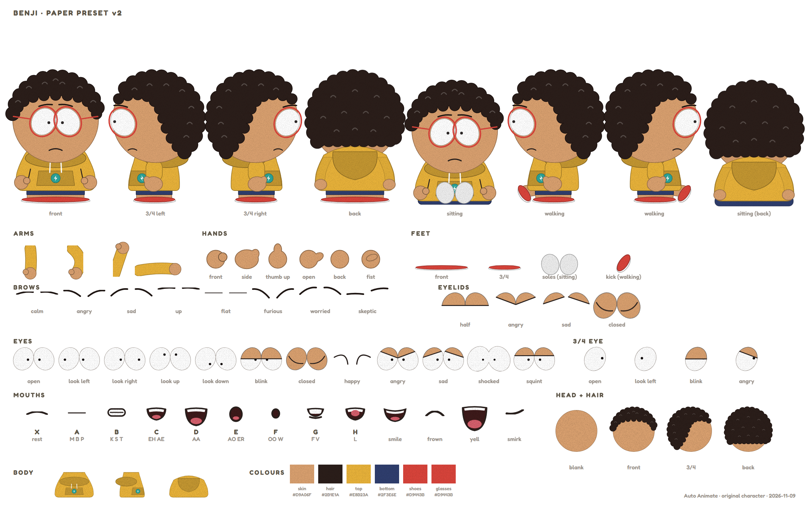

# 🎨 Auto Animate Robot

Makes **original animated shorts** (9:16, up to 60 s) in a simple **2D paper-cutout style**, all in code on a normal laptop:
a story script (JSON) → characters, scenes, props and effects drawn as SVG → a hidden browser takes each frame → free offline
voices (Kokoro / Piper) with automatic lip-sync and word-by-word captions → FFmpeg makes the MP4. No AI video generator.

Every character = **one base puppet** (body, head, eyes, mouths) + a **wardrobe** (hair, hat, clothes, colours).



## 🧰 Set up on a new PC
| Needs | Where |
|---|---|
| **Node.js 24+** (has the built-in WebSocket the frame camera uses) | nodejs.org |
| **FFmpeg** (with `rubberband`; NVENC is used when there is an NVIDIA card) | e.g. `winget install Gyan.FFmpeg` |
| **Microsoft Edge** (Windows) or **Chromium** (Linux: set `BROWSER=chromium`) | already on Windows |
| The **Fredoka** font (OFL) | `../tools/fonts/Fredoka-Bold.ttf`, `Fredoka-SemiBold.ttf` |
| **Kokoro** voices (natural, Apache-2.0): a Python 3 venv with `pip install kokoro-onnx soundfile`, plus `kokoro-v1.0.onnx` + `voices-v1.0.bin` from github.com/thewh1teagle/kokoro-onnx (release `model-files-v1.0`) | `../tools/kokoro/venv`, `../tools/kokoro/models` |
| **Piper** voices (older, optional): `piper.exe` + **public-domain** voices only (john, kristin, norman, cori) | `../tools/piper`, `../tools/piper-voices` |

The `tools` folder sits **next to** this folder (`HomeLab/autoanimate` + `HomeLab/tools`). Videos go to `out/` (not in git).
⚠️ Only use voices, music and fonts whose license allows a channel that earns money.

Two designs, the same wardrobe files:
- **v2 "paper preset"** (✅ approved 2026-11-09, used for every short), built on the user's **default body**: round head, touching eyes that lean in, a bell body with the arms inside, flat feet, one eye in 3/4, no outlines → `src/puppet2.js`. Frozen copies of the approved sheets, parts and code: `presets\v2`
- **v1** (frozen, the first approved look): thick outlines → `src/puppet.js`
- The first v2 try (before the default body) is kept in `old\v2-draft1` (not used)

## ▶️ Make the preset sheets (v2)
```
node make-presets.js
node make-presets.js benji
```
Makes `presets\<name>-preset.png` (8 poses + every part on one sheet) and 74 separate SVG parts in `presets\<name>\parts\`.

## ▶️ Make the character sheets (v1)
```
node make-sheets.js
node make-sheets.js benji
```
The first makes all sheets, the second just one. The pictures appear in `sheets\` (PNG + SVG).
It uses **Microsoft Edge** (already on Windows) to turn each SVG into a PNG, and the **Fredoka** font from `..\tools\fonts`.

## 🎬 Make a short
```
node make-short.js stories/viking-helmets.json
```
Makes `out\viking-helmets.mp4` (1080×1920, 24 fps, about 2 minutes on the PC).
Also makes `out\viking-helmets\` with the voice lines, `timeline.json` (when each word is said) and `check\` (one picture per beat).
Needs Piper + the voices in `..\tools\piper` and `..\tools\piper-voices`, FFmpeg, and Edge (already on Windows).

Options:
- `--workers=3`: how many hidden browsers draw at the same time (default 3). More = faster, but each needs ~0.3 GB of RAM (this laptop has 8 GB: close big apps while rendering)
- The final MP4 is made by the graphics card's encoder (NVENC) when there is one; `--cpu` uses the processor instead
- `--check`: only the check pictures, no video (about 10 seconds): quick to test a change
- `--design=v1`: the old outline look → `out\viking-helmets-v1.mp4` (the story's `"design"` sets the default, else v2)

A story file is the **script**: the scene, the cast (who stands where), the voices, then one **beat** per line:
who speaks, the words, what everyone does and how the camera sees it. Example with every new part: `stories\viking-horns.json`.

### 🎬 Story options from the Style Bible (2026-11-09)
| In the story | What it does |
|---|---|
| `"mood": "sunset"` | the light: `day`, `sunset` or `night` (sky colour, glow + rays at the sun, more contrast, soft dark corners). No mood = the plain look |
| `"fps": 30`, `"lead": 0`, `"gap": 0.12`, `"tail": 0.7` | 30 pictures a second, talking from the very first frame, short gaps between lines, how long the end lasts |
| `"captions": { "words": 2, "chars": 12, "y": 1420, "size": 100 }` | 1–2 words at a time, low on the screen, popping in |
| `"shot": "close bjorn push"` | one shot per line: `wide`, `medium <who>`, `close <who>`, `two <who> <who>`, `insert <card>` + a move: `push`, `pull`, `drift-left`, `drift-right`, `still` |
| `"cards": { "shop": { "kind": "sign", "title": [...], "art": { "style": "horned" }, "lines": [...] } }` | paper close-ups of objects. Kinds: `poster`, `sign`, `book`, `box`, `label`. Art = a hat drawn big |
| `"fx": ["steam bjorn", "sparkle benji hat", "flash"]` | effects: `steam`, `sweat`, `bang` ("!"), `sparkle` (`hat`, `head` or `chest`), `dust`, `flash`, `shake` |
| in `"cast"`: `"legs": "sit"`, `"bob": true`, `"hat": { "style": "pot" }`, `"chew": true`, `"hidden": true` | sit down / stand up, laugh (bobbing), change the hat (`helmet`, `horned`, `pot`, or `null` for none), chew, leave the scene |
| `"scene": "dining"`, `"mood": "lamp"` | the dining room at night (a big clean window with the city outside, a table in front of everyone) with warm lamp light |
| `"props": { "steak1": { "kind": "steak", "raw": true, "x": 190, "y": 1300 } }` | things in the scene: `steak` (raw or cooked), `plate`, `smear` (a juicy trail on glass) |
| in a line: `"props": { "steak1": { "x": 820, "y": 800, "fly": { "arc": 260, "spin": 700, "at": 1.6, "dur": 0.45 } } }` | move a prop: jump, `fly` (an arc + spin) or `slide`; `"layer": "near"` puts it behind the people, `"front"` in front |
| `"shot": "spot window"` / `"spot steak1"` | a close look at a place in the scene or at a prop |
| more `"fx"`: `"idea dale"`, `"splat 820 800"`, `"sparkle 860 620"` | a light bulb over a head, red drops flying out, a sparkle anywhere |
| cards: `"kind": "phone"` with `"bubbles"`, art `{ "style": "bird" }` | a text message on a phone; a dizzy paper bird |

Older stories (with `"camera"` instead of `"shot"`, no `"mood"`) still work the old way.
Test one moment: `node make-short.js stories/steak-window.json --check --at=30.7,31.2` (pictures at those seconds).

## 📁 Files
| File | What it is |
|---|---|
| `src/puppet2.js` | **v2** puppet on the default body: paper pieces, 12 eye poses, 8 brows, 13 mouths, 3/4 views (one eye), sit + walk legs, the wardrobe parts |
| `src/presets.js` + `make-presets.js` | the v2 preset sheet + the separate part files |
| `src/puppet.js` | **v1** puppet (kid + adult body, 9 eye poses, 9 lip-sync mouths) + the wardrobe parts |
| `src/sheets.js` | the v1 sheet layouts (turnaround sheet, base puppet sheet) |
| `characters/*.json` | one file per character: only its wardrobe |
| `make-sheets.js` | makes the v1 PNGs |
| `make-short.js` | makes a short from a story script |
| `src/scenes.js` | the backgrounds (fjord, dining room), split into depth layers (far, middle, near, front) |
| `src/look.js` | the Style Bible look: moods, glow, rays, contrast, vignette, ground shadows, the effects kit |
| `src/props.js` | the insert cards (paper close-ups of objects, a phone) + scene props (steak, plate, smear) |
| `characters/dale.json`, `rosa.json`, `margo.json` | the steak story's cast (husband, wife, boss) |
| `src/voices.js` | Piper voices + pitch, the voice track |
| `src/lipsync.js` | mouth shapes + word timings from the words and loudness |
| `src/renderer.js` | the frame camera (hidden Edge / Chromium) |
| `stories/*.json` | the story scripts |

## ➕ Make a new character
Copy `characters/benji.json`, change `id`, `name` and the wardrobe, then run `node make-presets.js <id>` (v2) or `node make-sheets.js <id>` (v1).

Parts you can use today:
- **body** `kid` · `adult` · **skin** `light` `peach` `tan` `brown` `deep` (or any `#colour`)
- **hair** `curly` · `bob` · `short` · `none` · **hat** `helmet`
- **top** `tee` · `hoodie` · `blazer` · `tunic` · **bottom** `shorts` · `pants` · `skirt`
- **shoes** `sneakers` · `flats` · `boots` · **extras** `glasses` · `pearls` · `beard` · `cape`
